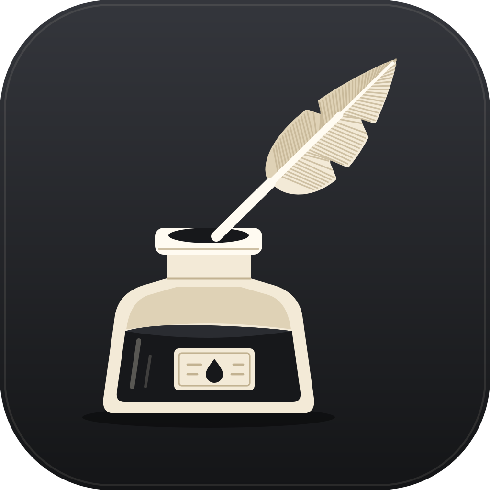
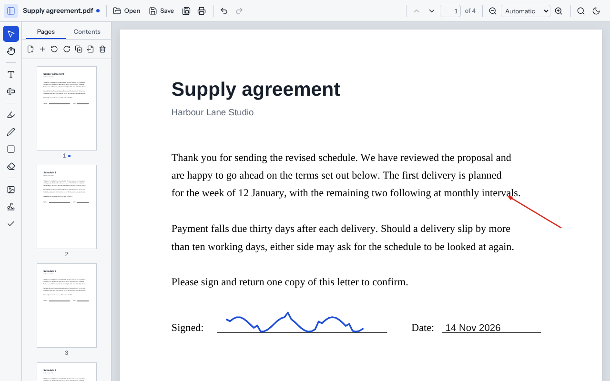

<p align="center"></p>

# Inkwell

A fast PDF viewer and editor for Windows that runs entirely on your own computer. Open a PDF, mark it
up, fill it in, sign it, rearrange its pages, and save. Nothing is uploaded anywhere.



## Download

Get **Inkwell Setup.exe** from the [latest release](../../releases/latest) and run it.

- The installer is not code-signed, so Windows shows "Windows protected your PC" the first time.
  Choose **More info**, then **Run anyway**.
- It installs for your user account only, with Desktop and Start menu shortcuts.
- To make it your default PDF app: right-click any PDF, **Open with**, **Choose another app**,
  **Inkwell**, **Always**.

Each release also carries **Inkwell.html**, the whole editor in one file. Open it in Chrome or Edge to
use Inkwell without installing anything.

## What it does

| | |
| --- | --- |
| **View** | Smooth scrolling, zoom, page thumbnails, table of contents, find, light and dark theme, recent files |
| **Mark up** | Highlight, underline, strike through, pen and marker, rectangles, ellipses, lines, arrows, ticks and crosses |
| **Text** | Add text anywhere, or click existing text to rewrite it in place |
| **Forms and signing** | Type into fillable form fields; draw or type a signature |
| **Images** | Place or paste PNG, JPEG, WebP, GIF, BMP and SVG images; white out an area |
| **Pages** | Reorder by dragging, rotate, duplicate, delete, add blank pages, merge other PDFs or images, save selected pages as a new PDF |
| **Print** | A preview of every sheet, with printer, copies, page range, paper, orientation, colour and two-sided options |

### Keyboard shortcuts

| Key | Does | Key | Does |
| --- | --- | --- | --- |
| `V` | Select, move, resize | `Ctrl+O` | Open |
| `H` | Pan | `Ctrl+S` | Save |
| `T` | Add text | `Ctrl+Shift+S` | Save as |
| `E` | Edit existing text | `Ctrl+Z` / `Ctrl+Y` | Undo / redo |
| `U` | Highlight, underline, strike | `Ctrl+F` | Find |
| `D` | Draw | `Ctrl+P` | Print |
| `R` `O` `L` `A` | Rectangle, ellipse, line, arrow | `Ctrl` + wheel | Zoom |
| `W` | White out | `Ctrl+0` | Automatic zoom |
| `I` | Place an image | `Delete` | Remove the selected item |
| `S` | Sign | Arrow keys | Nudge the selected item |
| `C` | Tick, cross, dot | `Esc` | Finish typing; again to go back to Select |

## Privacy

Inkwell never contacts the network. Your PDFs are read and written on your computer only.

- The app's Content-Security-Policy forbids every network connection, and the Windows app blocks
  network requests a second time at the session level.
- The Windows app can only read and write the files you open, drop in, or pick in a dialog.
- Settings, recent files and (if you choose) your signature are stored locally.
- **Browser edition only:** Chrome and Edge give every HTML file opened from disk the same storage
  area, so another local HTML file could read a remembered signature. "Remember this signature" is
  therefore off by default there. The Windows app has its own storage and is not affected.

## Known limitations

- **White-out and "edit text" cover the old text; they do not remove it from the file.** Do not rely
  on them to hide confidential information. Deleted pages, in contrast, are removed completely,
  including their form fields.
- **Edits become part of the page when you save.** After reopening a saved file, what you added can
  no longer be moved. Use **Save as** to keep an untouched original.
- **Password-protected PDFs are saved without their protection.** Inkwell asks before the first save.
- **Text outside Western European alphabets** (for example Cyrillic, Arabic, Chinese, emoji) that you
  add is saved as a sharp picture of the text, not as selectable text.
- **Printing sends pages as high-resolution images** (300 dpi for short jobs).
- Not supported: certificate-based digital signatures and dynamic XFA forms.
- The installer is unsigned (see Download).

## Building from source

You need [Node.js](https://nodejs.org) 20 or newer (developed and tested with Node 22).

```sh
npm install            # the editor's build tools
npm run build          # writes dist/Inkwell.html and desktop/app/index.html

cd desktop
npm install            # Electron and the installer builder
npm start              # run the desktop app
npm run dist           # build desktop/release/Inkwell Setup.exe (run this on Windows)
```

`npm run dist` rebuilds the editor first, so the installer always contains the current code.

### Tests

```sh
npx playwright install chromium     # once
npm run build
npm test                            # on Linux: xvfb-run -a npm test
```

The suite drives the real app with mouse and keyboard, saves through the Save button, and inspects
the PDFs that come out. The desktop tests start the Electron app and try to break its file and
network rules. They are skipped if the desktop dependencies are not installed.

### Layout

| Path | What it is |
| --- | --- |
| `src/` | The editor: one HTML file, one stylesheet, and the JavaScript in `src/js/` |
| `build.mjs` | Bundles the editor and its libraries into the single file `dist/Inkwell.html` |
| `notices.mjs` | Gathers the licence texts of the bundled libraries into `THIRD_PARTY_NOTICES.md` |
| `desktop/app/` | The Windows shell: window, file access, printing, security settings |
| `desktop/installer.nsh` | Installer step that removes the earlier "Blue Pencil" build |
| `desktop/art/`, `assets/` | Icons for the app and its PDF files; logo and screenshot |
| `tests/` | The automated tests |

### Releasing

1. Update the version in `package.json` and `desktop/package.json`, and add an entry to `CHANGELOG.md`.
2. Push a tag such as `v1.3.0`. The **Release** workflow builds the installer on Windows and attaches
   `Inkwell Setup.exe` and `Inkwell.html` to a new GitHub Release.
3. Or build locally with `npm run dist` and attach the two files to a release by hand.

Installers are over GitHub's 100 MB file limit and must never be committed; `.gitignore` keeps them out.

### Notes for maintainers

- **Do not change `appId`** (`local.inkwell.app` in `desktop/package.json`). Windows identifies the
  installed app by it; a new id would install a second copy next to the old one.
- **Storage keys start with `pdfeditor.`**, the project's working name. Renaming them would lose
  people's settings and saved signatures.
- **Blue Pencil** was the app's name in versions 1.0 and 1.1. `desktop/installer.nsh` removes that
  build and `desktop/app/main.js` carries its settings over. Both can go once nobody has it installed.

## Licence

Inkwell is released under the [MIT Licence](LICENSE).

It is built on [PDF.js](https://github.com/mozilla/pdf.js) (Apache-2.0),
[pdf-lib](https://github.com/cantoo-scribe/pdf-lib) (MIT), [Lucide](https://lucide.dev) icons (ISC),
[Instrument Sans](https://github.com/Instrument/instrument-sans) (SIL OFL 1.1) and, for the Windows
app, [Electron](https://www.electronjs.org) (MIT). Their full licence texts are in
[THIRD_PARTY_NOTICES.md](THIRD_PARTY_NOTICES.md), which is also installed with the app.
